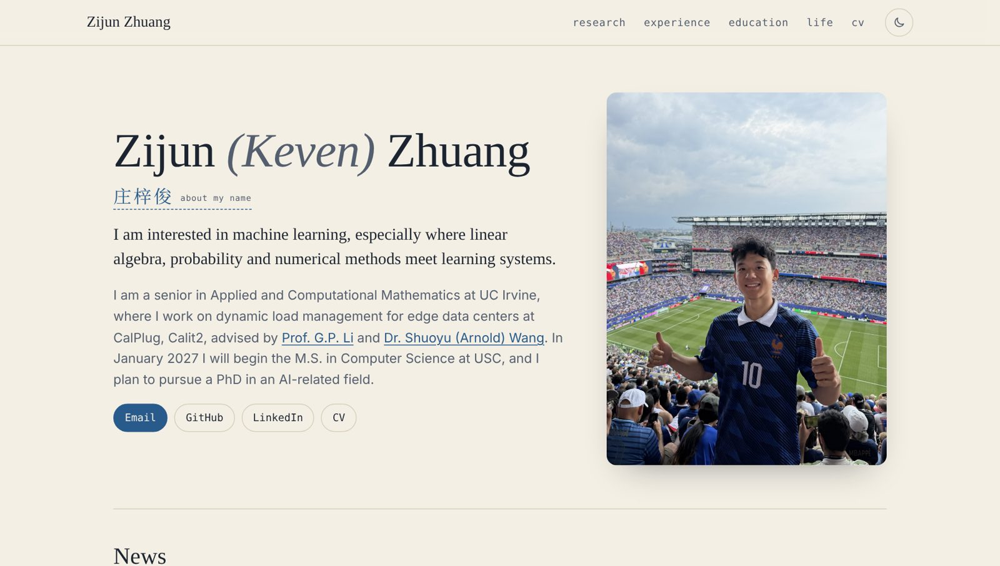

# Zijun (Keven) Zhuang

Source code for my personal website: **[kevenzhuang.github.io](https://kevenzhuang.github.io)**

I study Applied and Computational Mathematics at UC Irvine and will start the M.S. in Computer Science at USC in January 2027. I'm interested in machine learning, especially where linear algebra, probability and numerical methods meet learning systems.

## Pages

- [**Home**](https://kevenzhuang.github.io): research, experience and education
- [**Life**](https://kevenzhuang.github.io/life.html): the parts of me that aren't on my CV
- **404**: a small freediving game, if you take a wrong turn

Plain HTML, CSS and JavaScript, with no framework or build step. Hosted on GitHub Pages.

## Contact

zijunzhu [at] usc [dot] edu · [LinkedIn](https://www.linkedin.com/in/keven-zhuang-62643b3b6/)
